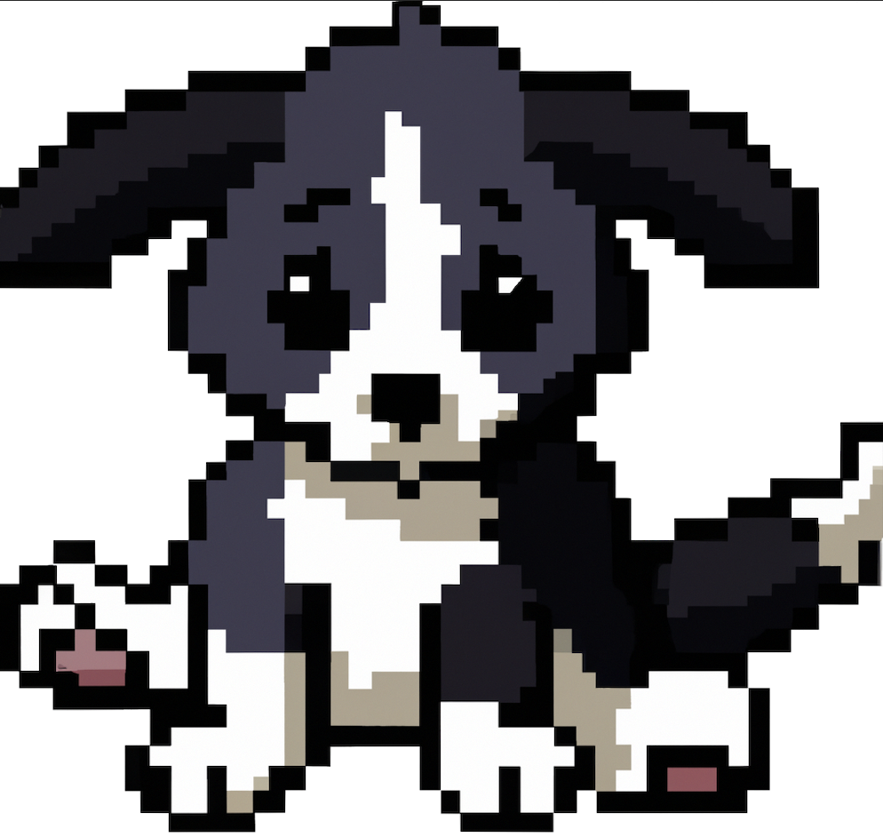
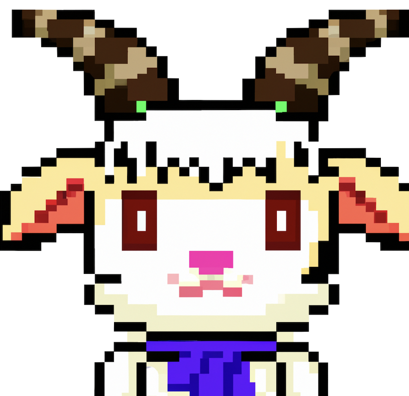
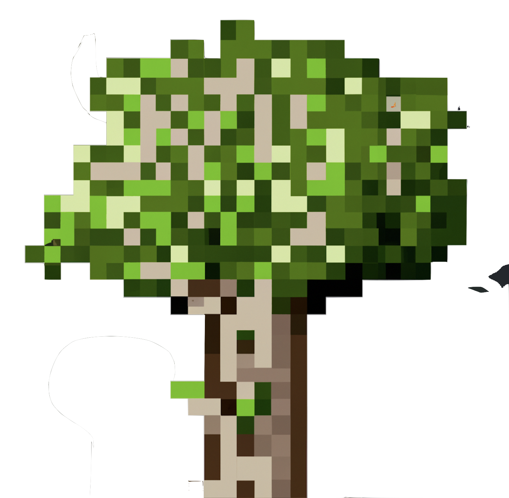
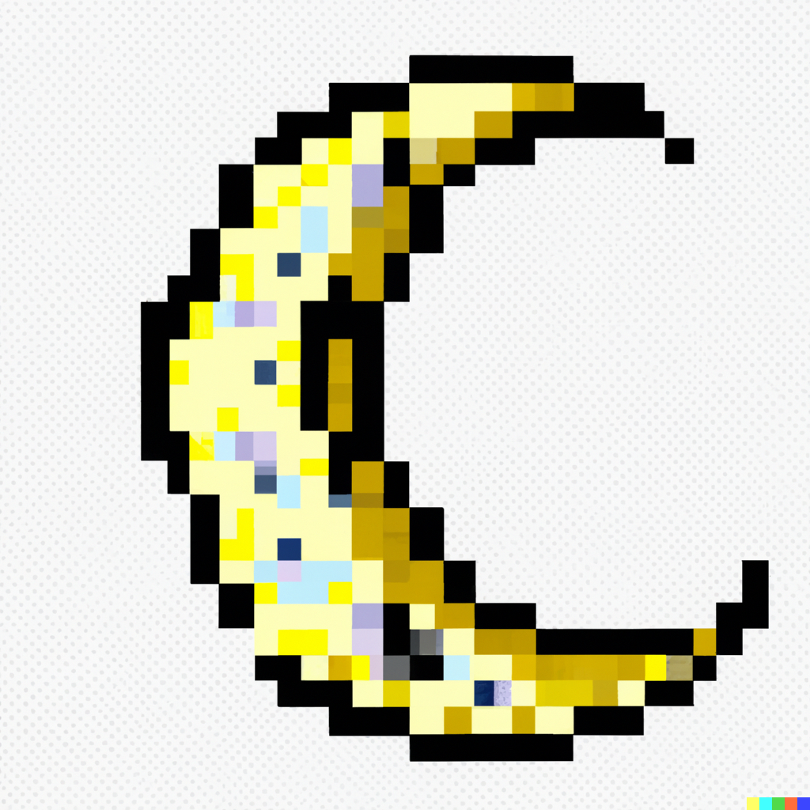

# Molly Beach — Portfolio

**Live at [mollybeach.app](https://mollybeach.app)**

### *A digital fabric of my life.*

This portfolio has two sides. The sidebar is a conventional résumé — experience, projects, skills, education, awards and certifications. The home page is **the Palais**: an interactive, Versailles-style palace terrace, built entirely from hundreds of hand-made stickers of my animals, plants and furniture, and rendered across all four seasons. From there it opens onto **the Atlas**, an explorable world of rooms, each modeled on places I've travelled.

It's React, TypeScript and CSS, with no game engine and no canvas library. It all runs in the browser.

---

<b>📖 More — how the Palais works, the rooms &amp; the tech stack</b>

 

## ✨ The Palais

### A room that lives through the year
- **Four seasons on an 80-second year.** Spring, summer, autumn and winter photographs crossfade on a CSS animation timeline. **Skip** jumps ahead by driving the animations directly through the Web Animations API (`currentTime`, `playbackRate`), and **Pause** freezes the whole year, every room at once.
- **Weather that follows the photographs.** Snow in winter, falling leaves in autumn and cottonwood fluff in summer come from a canvas particle system. It reads how far each season's photo has faded in, so the weather thickens as a season arrives and thins as it leaves.
- **Visitors.** Hummingbirds and dragonflies fly through now and then on a small requestAnimationFrame flight engine.
- **Moving parts.** Honeysuckle's tricycle wheels spin, and her sewing machine's needle goes up and down while the fabric feeds through. Each sticker is cut into layers and animated separately.
- **Phone layout.** Phones get their own portrait photographs and layout rather than a squashed desktop.

### ~100 stickers you can rearrange
- **Drag anything anywhere.** Pick-up hit-testing checks the image's own transparency, so you grab the cat and not the empty corner of its picture. The item you're holding comes to the front, and a corner handle resizes it.
- **Positions that survive resizing.** Moves are stored as fractions of the stage (container query units, `cqw`/`cqh`), so an arrangement holds at any window size. The scene is mapped onto whichever background photo is showing: taller, wider or phone.
- **A dress-up-game catalogue.** Every sticker sits on a shelf (Furniture, House plants, Cats, Dogs, Goats, Artwork, Hanging lights, Teacups, Trinkets…). Heart them in or out of the room, one at a time or a whole shelf at once.
- **A layout for each season.** Each season has its own default arrangement: the autumn table only in autumn, the dogs in the pool in spring and summer. The room glides into the new layout when the season turns.

### Area M: the world map
A cute, video-game-style level select. Honeysuckle hops along a dotted path between stops on an island inside a shimmering rainbow wall. Each stop is a region blended from real trips, and many of them are rooms you can walk into:

| Room | |
|---|---|
| 🏛 The Palais | home, the terrace |
| 🍰 The Kitchen | the whole kitchen behind the terrace's marble bar |
| 🛁 The Bathroom | the blush bathroom through the terrace's right arch |
| 🌿 The Glasshouse | an iron-and-glass garden conservatory |
| 🏠 The Lakehouse | a glass lake house with a red bridge and a boathouse, in four seasons |
| 👗 The Wardrobe Wing | a pink closet with lemon wallpaper and a waterfall, in four seasons |
| ♨️ The Steaming Lagoon | a blue lagoon under the northern lights, in four seasons |
| 🌲 The Rainwood | a fern-covered conservatory in a rainforest |
| 🎵 The Amphitheatre | a festival stage on a canyon rim at sunset |
| 🕌 The City of Domes | a marble bath above domes, trams and gondolas |
| 💜 The Jacaranda Quarter | a balcony over a purple jacaranda street at dusk |
| 🐢 The Glass Reef | a seashell pavilion half under the sea |

Rooms keep their place in the address (`mollybeach.app/#lagoon`), so a refresh or a shared link opens the same room. All rooms turn through the seasons together.

### Saved Looks
Signed in, I can save the room as a named look, file it under a season, make it that season's default, and keep older looks to go back to. Everyone can read looks, but only editors can change them, and row-level security enforces that in the database, not in the UI.

---

## 📄 The résumé side

- **Experience:** an expandable timeline of roles, with project details
- **Projects:** project cards with live preview screenshots (Microlink)
- **Skills, Education, Awards, Certifications**
- **Résumé:** a printable résumé page
- **Link previews:** social media previews and meta tags (react-helmet-async)

## 🛠 Tech stack

- **React 18** + **TypeScript** (Create React App), **react-router**
- **Tailwind CSS** for the résumé pages; hand-written, scoped CSS for the Palais (container queries, CSS animations, custom properties)
- **Web Animations API**, **Canvas 2D**, **requestAnimationFrame**, **ResizeObserver**
- **Supabase** (Postgres, row-level security, auth, SQL functions), loaded lazily so the room never waits on it
- **Image pipeline:** background removal (rembg), OpenCV feature matching (SIFT and homography) to align the season photographs, WebP export
- **Hosting:** Vercel

  
  &nbsp;
  

  

        
        
        
        
        
        
         
        
        
        
        
        
       
        
        
        
        
        
        
        
        
        
        
        
        </img> 
        </img>   
        </img> 
         </img> 
        </img>     
        </img>
        </img>

 

<table><tr><td valign="top" width="50%">
        <h2 align="center"> 💼 Languages and Tools</h2>
 

 

</td><td align="top" width="50%">

</tr></tr></table>

 

---

## 📞 Contact

- [LinkedIn](https://www.linkedin.com/in/mollybeach)
- [GitHub](https://github.com/mollybeach)
- [mollyjbeach@gmail.com](mailto:mollyjbeach@gmail.com)
